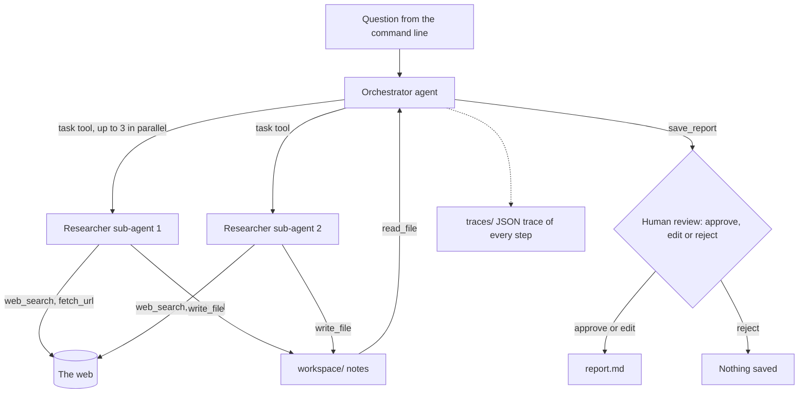

# Research Agent

A research agent that takes a question, searches the web, reads sources, and returns a short answer with citations (source URLs). A person reviews the answer before it is saved.

It is built step by step, following `build_step.md`, as a way to learn how agents work. This README is updated after every step. When the project is finished, it is the project's documentation. For plain-language explanations of why each step was done, see `EXPLANATIONS.md`.

## Status

| Step | What | Status |
|------|------|--------|
| 0 | Project setup (venv, git, packages, keys) | Done |
| 1 | Spec and project rules | Done |
| 2 | Hand-written tool-calling loop | Done |
| 3 | Web search and fetch tools | Done |
| 4 | Deep Agents harness | Done |
| 5 | Run tracing | Done |
| 6 | Shared filesystem | Done |
| 7 | Sub-agents | Done |
| 8 | Human approval before saving | Done |
| 9 | Eval questions | Done (12 questions, drafted together, facts verified 2026-11-23) |
| 10 | Eval runner | Done (built and smoke-tested; not yet run on the real questions) |
| 11 | Baseline results | Not started |
| 12 | One change, measured | Not started |
| 13 | Final README and demo | Not started |
| 14 | Cleanup | Not started |

## How it works



1. **Orchestrator.** The main agent has no web tools. It splits the question into 2 to 3 subtopics and delegates each one with the `task` tool.
2. **Researcher sub-agents.** Each one has a fresh context, researches one subtopic with `web_search` and `fetch_url`, and writes its notes (URLs and key facts) to a file in `workspace/`.
3. **Combine.** The orchestrator reads the notes files and writes one short answer with a Sources list.
4. **Approval.** The orchestrator calls `save_report`. The run pauses (a LangGraph interrupt) and shows the draft. You type `approve`, `edit` or `reject`. Only approved or edited text is written to `report.md`.
5. **Trace.** Every model call, tool call and tool result, including those inside sub-agents, is printed and saved to `traces/<timestamp>.json`.

### The two tools

| Tool | What it does |
|------|--------------|
| `web_search(query)` | Searches with Tavily. Returns up to 5 results, each with title, URL and snippet. |
| `fetch_url(url)` | Downloads a page (`httpx`), extracts readable text (`trafilatura`), and truncates it to 4,000 characters. |

Both are defined in `raw_loop.py`, and `agent.py` reuses them. They return errors as text so the model can react instead of crashing.

## Setup (Windows, PowerShell)

```powershell
python -m venv .venv
.\.venv\Scripts\Activate.ps1
pip install deepagents langgraph python-dotenv google-genai tavily-python httpx trafilatura
```

Create a `.env` file in the project folder (it is git-ignored):

```
GOOGLE_API_KEY=your-gemini-key
TAVILY_API_KEY=your-tavily-key
GEMINI_MODEL=gemini-3.5-flash-lite
```

| Variable | Needed | What for |
|----------|--------|----------|
| `GOOGLE_API_KEY` | Yes | Gemini model access |
| `TAVILY_API_KEY` | Yes | Web search (free key at tavily.com) |
| `GEMINI_MODEL` | No | Model name. Default is `gemini-3.5-flash-lite`. Check Google's pricing page for the current cheapest model. |

Set a spending limit in your Google dashboard before running.

## Usage

Run the research agent:

```powershell
python agent.py "Compare the main approaches to evaluating LLM agents."
```

The terminal shows each step as it happens. When the draft is ready you are asked `approve / reject / edit`. For `edit`, type the new report and finish with a line containing only `END`.

Run the Step 2-3 hand-written loop, which shows what the framework does for you:

```powershell
python raw_loop.py
```

## Project layout

```
Research agent/
├── agent.py           # The agent: orchestrator, sub-agent, approval step, tracing (Steps 4-8)
├── raw_loop.py        # Hand-written tool-calling loop and the two tools (Steps 2-3)
├── evals/
│   ├── run_evals.py   # Runs the agent on every question and scores it (Step 10)
│   ├── questions.json # The 12 test questions (Step 9)
│   └── results/       # One JSON result file per eval run
├── SPEC.md            # What we are building and what is out of scope
├── CLAUDE.md          # Working rules for Claude Code
├── build_step.md      # The step-by-step build guide
├── EXPLANATIONS.md    # What each step did and why, in plain language
├── README.md          # This file
├── report.md          # The approved report (created by a run, git-ignored)
├── workspace/         # The agent's notes; cleared at the start of every run (git-ignored)
├── traces/            # One JSON trace per run (git-ignored)
├── .env               # API keys (git-ignored)
├── .gitignore
└── .venv/             # Python virtual environment (git-ignored)
```

## Known limitations

These are observed in the traces so far and will be measured by the evals.

- **The agent often skips `fetch_url`.** In several runs it answered from search snippets and cited pages it never read, even though the prompt tells it to fetch pages. Citations may therefore not reflect pages actually read. Step 10 scores this, and Step 12 is where a fix is tried.
- **The 3 sub-agent limit is a prompt instruction**, not a hard cap. The docs describe no setting for it.
- **Fetched pages are cut to 4,000 characters**, so an answer that sits further down a page can be missed.
- **The pause lives in memory** (`MemorySaver`). Closing the terminal at the approval prompt loses the run.
- **The model sometimes calls `save_report` twice**, which gives you a second draft to review.
- **Eval scoring is simple text matching**, so correct answers phrased differently can be marked wrong, and a fetched page does not prove the cited claim is on it.
- **Eval runs overwrite `report.md`**, because approval is switched off and every answer is saved.
- **No evaluation results yet.** Scores will be added after Steps 10 to 12. No numbers are claimed here before then.

## Evals

`python evals/run_evals.py` runs the agent on every question in `evals/questions.json` with human approval switched off, and scores each answer three ways:

| Score | How it is measured |
|-------|--------------------|
| Correctness | Fraction of the question's `key_facts` that appear in the answer (case-insensitive text match). |
| Citation accuracy | Of the URLs the answer cites, the fraction the agent actually fetched during the run, read from the trace. An answer with no URLs scores 0. |
| Cost | Model calls, tool calls and total tokens, counted over the orchestrator and all sub-agents. |

It prints one line per question and a summary, and saves everything to `evals/results/<timestamp>.json`. Each question's trace is saved in `traces/`. Pass another file as an argument to use different questions: `python evals/run_evals.py path/to/questions.json`.

The question set (`evals/questions.json`, 12 entries) has 7 easy single-fact questions, 1 that needs a detail deep in a page (to test the 4,000-character cut), 2 that need two sources, and 2 with no clear answer (a future prediction and a version that does not exist). `expected_source` is a URL, or a list of URLs for two-source questions.

Many answers change over time, so **the set was verified on 2026-11-23** and some facts (latest Python, Rust and langgraph versions, TIOBE's monthly rating) will go stale. Re-check them before a new baseline run. The two no-clear-answer questions use loose `key_facts` (`predict`; `3.99` and `does not exist`) and will score unreliably.

The text match is strict: a correct answer phrased differently from your `key_facts` can score low. Baseline numbers will be added after Step 11.

## Out of scope

A web UI, a database, deployment, and an LLM judge for scoring (the first evals use simple text matching).

## Build log

What was done in each step, in order. Details and reasoning are in `EXPLANATIONS.md`.

### Step 0: Project setup
- Created a git repository and a Python virtual environment (`.venv`).
- Installed `deepagents`, `langgraph` and `python-dotenv`.
- Added `.gitignore` and a placeholder `.env`.

### Step 1: Spec and project rules
- Switched the model provider to Google Gemini (`GOOGLE_API_KEY` in `.env`).
- Wrote `SPEC.md`: goal, version 1 scope (one agent, two tools, one answer with sources), output format, allowed dependencies, and the out-of-scope list.
- Wrote `CLAUDE.md`: the working rules for every step.
- No code yet.

### Step 2: Hand-written tool-calling loop
- Installed `google-genai` (the Gemini SDK, already allowed in `SPEC.md`).
- Created `raw_loop.py`: a loop with no agent framework and one demo tool, `add_numbers(a, b)`.
- It sends the question, runs any tool the model asks for, sends the result back, and stops on a final answer or after 5 steps.

### Step 3: Real web tools
- Chose Tavily for search and `httpx` + `trafilatura` for reading pages. Installed `tavily-python`, `httpx`, `trafilatura`.
- In `raw_loop.py`, replaced `add_numbers` with `web_search(query)` and `fetch_url(url)`. The loop is unchanged.
- The test question became "What is the latest stable version of Python? Cite the URLs you used."

### Step 4: Deep Agents harness
- Created `agent.py`: builds an agent with `create_deep_agent`, the same two tools, and a system prompt that says to search, read sources, and end with a Sources list.
- It answers the question given on the command line. `raw_loop.py` is kept for comparison, and `agent.py` imports its tool functions.
- Docs used: https://docs.langchain.com/oss/python/deepagents/quickstart

### Step 5: Run tracing
- `agent.py` streams the run with LangGraph's `stream_mode="updates"` and prints each model call, tool call (with arguments) and tool result as it happens.
- The full trace is saved to `traces/<timestamp>.json`. `traces/` is in `.gitignore`.
- First trace finding: the agent cited URLs it never fetched (zero `fetch_url` calls). See Known limitations.

### Step 6: Shared workspace filesystem
- The agent can save notes with `write_file` and read them back with `read_file`. Files live in `workspace/`, which is deleted and recreated at the start of every run.
- Backend: a `CompositeBackend`. `/workspace/` maps to real files on disk (`FilesystemBackend` with `virtual_mode=True`, so the agent cannot reach `.env` or other project files), and everything else stays in memory (`StateBackend`).
- Docs used: https://docs.langchain.com/oss/python/deepagents/backends

### Step 7: Sub-agents
- The orchestrator has no web tools. It delegates each subtopic to a `researcher` sub-agent through the `task` tool. The researcher has `web_search` and `fetch_url` and writes notes to a file in `workspace/`.
- The limit of 3 sub-agents is set in the orchestrator's prompt (`MAX_SUBAGENTS = 3`).
- The trace now also streams what happens inside each sub-agent (`subgraphs=True`), and each trace event has a `source` field.
- Test run on a broad question: 2 sub-agents ran in parallel, one notes file each, 15 model calls, about 88,000 tokens. The sub-agents made no `fetch_url` calls.
- Docs used: https://docs.langchain.com/oss/python/deepagents/subagents

### Step 8: Human approval before saving
- The orchestrator ends by calling a `save_report` tool that writes `report.md`. The tool is listed in `interrupt_on`, so the run pauses before it runs.
- The terminal shows the draft and asks `approve / reject / edit`. A `MemorySaver` checkpointer stores the run's state at the pause, so it resumes with `Command(resume=...)`.
- Tested: approve writes the draft, edit writes your text, reject writes nothing.
- Docs used: https://docs.langchain.com/oss/python/deepagents/human-in-the-loop

### Step 9: Eval questions
- Drafted 12 questions together in `evals/questions.json`. Claude Code proposed candidates and verified each key fact against the live source page; the final set was approved by the project owner.
- Check run: every entry has all three fields, and all 6 distinct source URLs returned HTTP 200.

### Step 10: Eval runner
- Added `evals/run_evals.py`: runs the agent on each question with approval switched off and scores correctness, citation accuracy and cost. See the Evals section.
- Small change to `agent.py`: `run_with_trace` takes `auto_approve` and `verbose` options, and `run_question` / `final_answer` were split out of `main`. Interactive use is unchanged.
- Tested the scoring functions with fixed inputs, then ran a 2-question throwaway file end to end. No questions file existed yet, so there is no baseline. The smoke-test results were deleted.
