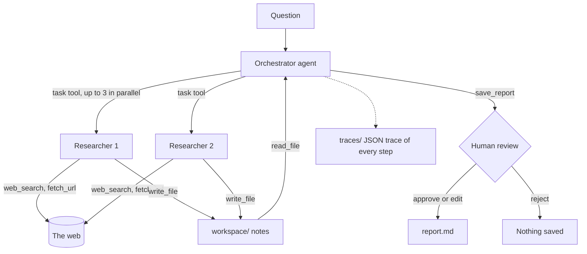

# Research Agent

A web research agent that takes a question, searches the web, reads sources and returns a short, cited answer. It is built on [Deep Agents](https://docs.langchain.com/oss/python/deepagents/overview) and LangGraph with Google Gemini, and it comes with a trace viewer and an eval suite that measures how trustworthy its citations are.

**The short version of what I found:** the agent usually answers correctly, but it often cites pages it never opened. I measured that, tried one fix, saw it make answers worse, and reverted it. The details, the failed experiment included, are documented below and in [`EVALS.md`](EVALS.md).

## Try it without an API key

A small FastAPI app replays three real recorded runs as a step-by-step timeline: every search, page opened, note written and approval, with token counts. It calls no model and needs no keys.

```bash
pip install fastapi uvicorn
python demo/server.py
```

Open http://127.0.0.1:8000.

- **Latest Python version:** a simple lookup, ending with the human approval step.
- **Comparing agent evaluation methods:** two researcher sub-agents working in parallel.
- **A stale source:** the agent trusts an outdated page and answers wrongly. This is the clearest example of why the evals exist.

Each run ends with the final answer, a **citation check** (was each cited URL actually opened?) and, where it applies, the eval score. The page works in light and dark themes and at phone width. Set `PORT` if 8000 is taken.

### Hosting the viewer

The viewer needs only `requirements-demo.txt` (FastAPI and uvicorn), reads read-only JSON files, and holds no keys, so it is safe to put on a public URL. `render.yaml` is a [Render](https://render.com) Blueprint that deploys it as a free web service: connect the repo on Render, choose **New, Blueprint**, and apply. The server listens on the `PORT` Render provides. On the free plan the service sleeps after a period of inactivity, so the first load after a quiet spell can take around a minute.

## How it works



1. The **orchestrator** has no web tools. It splits the question into 2 to 3 subtopics and delegates each with the `task` tool.
2. Each **researcher sub-agent** has a fresh context, searches and reads pages, and writes its notes (URLs and key facts) to a file in `workspace/`.
3. The orchestrator reads the notes and writes one short answer with a Sources list.
4. Before anything is saved, the run **pauses for human review** (a LangGraph interrupt). You approve, edit or reject the draft. Only approved or edited text is written to `report.md`.
5. Every model call, tool call and result, including those inside sub-agents, is **traced** to `traces/<timestamp>.json`.

| Tool | What it does |
|------|--------------|
| `web_search(query)` | Tavily search. Returns up to 5 results with title, URL and snippet. |
| `fetch_url(url)` | Downloads a page with `httpx`, extracts the readable text with `trafilatura`, and truncates it to 4,000 characters. |

`raw_loop.py` is the same loop written by hand with no framework, which is useful for seeing what the harness does for you.

## Results

Each version was run once on the 12 questions in [`evals/questions.json`](evals/questions.json), using `gemini-3.5-flash-lite`.

| Measure | Baseline (2026-11-23) | With one fix (2026-11-24, reverted) |
|---------|-----------------------|-------------------------------------|
| Correctness | 0.92 (11 of 12 fully correct) | 0.79 as scored, 0.71 after fixing one scoring false positive |
| Citation accuracy | 0.27 | 0.69 |
| Cited pages never opened | 35 | 13 |
| Questions with no page opened | 3 | 1 |
| Tokens per question | about 53,500 | about 75,000 |

- **The finding:** correctness is high because search snippets often contain the answer. Citation accuracy is low because the agent lists sources it never opened. All 35 unopened citations in the baseline did appear in search results, so they were unread, not invented.
- **The fix tried:** require researchers to record only URLs of pages they fetched. It raised citation accuracy, but the agent then fetched stale or incomplete pages and trusted them (for example a February 2025 copy of a ranking). Answers got worse and cost about 40% more tokens, so I reverted it.
- **The lesson:** forcing a fetch does not make the agent fetch the right page.

Per-question tables, the three worst questions and the failure analysis are in [`EVALS.md`](EVALS.md).

## Run the agent yourself

Tested with Python 3.13.1 on Windows (PowerShell). You need two API keys: a [Gemini key](https://aistudio.google.com/) and a free [Tavily key](https://tavily.com).

```powershell
python -m venv .venv
.\.venv\Scripts\Activate.ps1
pip install deepagents langgraph python-dotenv google-genai tavily-python httpx trafilatura fastapi uvicorn
```

Create a `.env` file (it is git-ignored):

```
GOOGLE_API_KEY=your-gemini-key
TAVILY_API_KEY=your-tavily-key
GEMINI_MODEL=gemini-3.5-flash-lite
```

`GEMINI_MODEL` is optional. Check Google's pricing page for the current cheapest model. Set a spending limit in your Google dashboard before running.

```powershell
python agent.py "Compare the main approaches to evaluating LLM agents."
```

The terminal prints each step as it happens, then asks `approve / reject / edit`. For `edit`, type the new report and finish with a line containing only `END`. One question typically uses about 40,000 to 200,000 tokens because of the sub-agents.

Tested with: `deepagents` 0.7.41, `langgraph` 1.2.24, `langchain-google-genai` 4.5.2, `google-genai` 3.6.1, `tavily-python` 0.8.5, `httpx` 0.28.1, `trafilatura` 2.4.0, `python-dotenv` 1.2.4, `fastapi` 0.165.0, `uvicorn` 0.54.0. These libraries change quickly, so check versions first if something breaks.

## Evals

```powershell
python evals/run_evals.py
```

Runs the agent on every question with human approval switched off and scores each answer three ways:

| Score | How it is measured |
|-------|--------------------|
| Correctness | Fraction of the question's `key_facts` found in the answer (case-insensitive text match). |
| Citation accuracy | Of the URLs the answer cites, the fraction the agent actually fetched during the run, read from the trace. An answer with no URLs scores 0. |
| Cost | Model calls, tool calls and total tokens, across the orchestrator and all sub-agents. |

Results go to `evals/results/<timestamp>.json`, and each question's trace to `traces/`. The 12 questions are 7 easy single-fact lookups, 1 that needs a detail deep in a page, 2 that need two sources, and 2 with no clear answer. Many answers change over time (software versions, a monthly ranking), so the set was verified on 2026-11-23 and should be re-checked before a new run. A full run costs roughly 640,000 to 900,000 tokens.

## Known limitations

**Agent behavior**
- Citations are often unread pages (baseline citation accuracy 0.27). The one fix tried made things worse, so the problem is open.
- Fetching a page is not proof of a good source. The agent can fetch a stale or third-party page, and `fetch_url` keeps only the first 4,000 characters.
- Answers can be confidently wrong. A question about the future ("latest Python in January 2030") got a flat "Python 3.18" with no hedge.
- The limit of 3 sub-agents is a prompt instruction, not a hard cap. The model sometimes calls `save_report` twice. The approval pause lives in memory, so closing the terminal at the prompt loses the run.

**Evals**
- Scoring is a plain substring match. A correct answer phrased differently can score low, and `predict` also matches "predictable", which inflated one score.
- One run per version, so run-to-run noise is unmeasured. The question set is small (12) and time-sensitive, and the two no-clear-answer questions score unreliably.

**Replay viewer**
- It replays recorded runs only, and visitors cannot ask their own question. A live mode would need per-run workspaces, rate limits, a spending cap and protection against the model fetching internal addresses.

## What I would build next

1. Fix the scorer: match key facts on word boundaries, and find a better way to score the no-clear-answer questions.
2. Measure noise by rerunning the baseline two or three times, so differences between versions can be judged against the spread.
3. Improve `fetch_url` so facts below the 4,000-character cut can be read.
4. Steer researchers toward official sources, then retry the "record only fetched URLs" rule on top of that.
5. Enforce limits in code, not prompts: a hard sub-agent cap, and a required fetch before a source can be cited.
6. Persist the approval pause with a database-backed checkpointer.
7. A larger, harder question set, including multi-hop questions with facts that don't go stale.

## Project layout

```
agent.py             The agent: orchestrator, sub-agent, approval step, tracing
raw_loop.py          Hand-written tool-calling loop, and the two tools
evals/
  run_evals.py       Runs the agent on every question and scores it
  questions.json     The 12 test questions
  results/           Saved results: the baseline and the reverted experiment
demo/
  server.py          FastAPI replay server (no model, no keys)
  build_examples.py  Builds demo/examples/ from saved traces and results
  examples/          The recorded runs shown by the viewer
  static/            The viewer page: index.html, style.css, app.js
requirements-demo.txt  Dependencies for the replay viewer only
render.yaml          Render Blueprint for hosting the viewer
EVALS.md             Eval results and failure analysis
EXPLANATIONS.md      Step-by-step build notes in plain language
SPEC.md              Scope of the project
CLAUDE.md            Working rules used while building
build_step.md        The build guide this project followed
```

`workspace/`, `traces/` and `report.md` are created by runs and git-ignored.

## How this was built

This is a learning project, built step by step with Claude Code following [`build_step.md`](build_step.md): a hand-written tool loop first, then the Deep Agents harness, tracing, a shared filesystem, sub-agents, human approval, an eval suite, a measured experiment, and finally the replay viewer.
